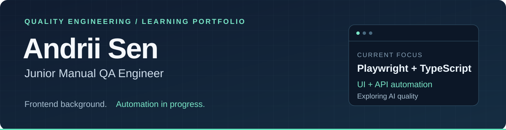

  <a href="#selected-project-experience">Project experience</a> &nbsp; / &nbsp;
  <a href="#automation-portfolio">Automation portfolio</a> &nbsp; / &nbsp;
  <a href="#toolkit--learning">Toolkit &amp; learning</a>

I'm **Andrii**, a Junior Manual QA Engineer with previous frontend development experience and a strong JavaScript/TypeScript foundation. I'm pursuing a **Master's degree in Computer Science** and building practical skills in QA automation, with a longer-term focus on **AI Quality Engineering**.

## Selected project experience

Projects I have worked on through GitHub accounts other than this one. My contributions are part of their team history, so they are not reflected in this account's repositories or contribution graph.

| Project | Product | Production link |
| :--- | :--- | :--- |
| **OptionScout** | Options calculator and strategy visualizer | [optionscout.com ↗](https://optionscout.com/) |
| **CrewCost** | Construction accounting software | [crewcost.com ↗](https://www.crewcost.com/) |
| **Kickly** | Template-based visual content editor | [app.kickly.net ↗](https://app.kickly.net/) |
| **Inforce Digital** | Software development company website | [inforce.digital ↗](https://inforce.digital/) |

## Automation portfolio

### Playwright + TypeScript

A learning project built around a local task application, with a focus on independent tests, readable assertions and useful failure reports.

| Test design | Framework | Delivery |
| :--- | :--- | :--- |
| UI and REST API scenarios | Page Object Model and custom fixtures | GitHub Actions on Ubuntu 24.04 |
| Positive, negative and boundary cases | Per-test data isolation and cleanup | Strict TypeScript checks |
| Chromium, Firefox and WebKit | Reusable API client and test data | HTML/JUnit reports and failure traces |

**Verified CI: 45/45 passed** — 24 API tests and 7 UI tests in each of three browsers. The repository is currently **private**; a public link will follow publication.

## Toolkit & learning

| Area | Current toolkit |
| :--- | :--- |
| **QA foundation** | Manual testing · API testing · SQL · Browser DevTools |
| **Development background** | JavaScript · TypeScript · HTML · CSS |
| **Version control** | Git · GitHub |
| **Actively developing** | Playwright · GitHub Actions · UI/API automation |
| **Exploring next** | LLM evaluation · Evaluation datasets · AI regression testing |

<strong>Earlier frontend repositories</strong>

- [rss-feeds](https://github.com/AndriiSen/rss-feeds)
- [universe-tt](https://github.com/AndriiSen/universe-tt)

---

**Direction:** QA Automation Engineer → deeper expertise in AI Quality Engineering.

Project experience above reflects team contributions. The automation framework documents my current learning and practice.
